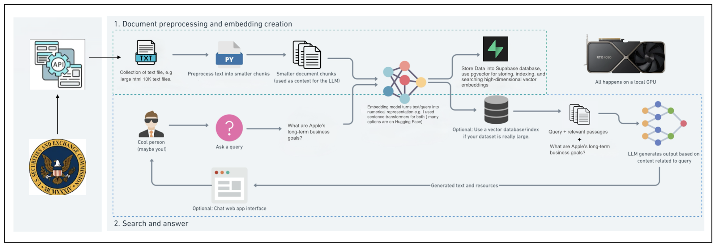

# RAG-Driven SEC 10-K Analyzer

A production-oriented **Retrieval-Augmented Generation (RAG)** system for querying and summarizing SEC 10-K filings with **structural correctness**, **traceable retrieval**, and **low-latency semantic search**.

This project uses **Apple Inc. 10-K filings** as the initial dataset and is easily extensible to any SEC filer.

---

## Why This Project Exists

Most RAG demos fail on real financial documents because they:
- Chunk text arbitrarily
- Ignore document structure
- Lose traceability to source sections
- Don’t scale to long filings like 10-Ks

This system is deliberately designed to:
- Preserve **SEC filing structure**
- Enable **item-level retrieval** (Item 1, 7, 8, etc.)
- Keep ingestion predictable and fast
- Avoid unnecessary system complexity

---

## Architecture Overview



---

## Data Processing Pipeline

### 1. Data Ingestion
- Downloads raw **10-K HTML filings** directly from SEC EDGAR.
- Uses a compliant SEC user agent.

### 2. Item-Wise Parsing
- Extracts official SEC sections using **regex-based indexing**.
- Each chunk is explicitly tied to an SEC item (e.g., Item 7: MD&A).

**Why:** Financial queries are section-specific. Treating a 10-K as flat text is objectively wrong.

### 3. HTML Cleaning & Table Preservation
- Removes noisy HTML while preserving `<table>` elements.
- Tables remain inside their original item context.

**Why:** Tables contain critical financial data and must not be detached from narrative context.

### 4. Chunking Strategy
- Recursive chunking applied **within SEC items**.
- Semantic chunking intentionally avoided.

**Trade-off:**  
Lower semantic granularity → faster ingestion, simpler pipeline, predictable retrieval.

---

## Embedding & Retrieval

- **Embedding Model:** `sentence-transformers/all-mpnet-base-v2`
- Same model used for documents and queries (no embedding mismatch).
- Stored in **Supabase PostgreSQL** using `pgvector`.
- **Cosine similarity** for Top-K retrieval.

---

## RAG Chat Application

- Built with **Next.js (App Router)**.
- Supabase integrated via `@supabase/supabase-js`.

### Query Flow
1. User query → embedding
2. Top-K chunks retrieved from pgvector
3. Chunks injected into LLM prompt
4. Final answer grounded in retrieved SEC sections

---

## Tech Stack

- **Python** – ingestion, parsing, embedding
- **BeautifulSoup** – HTML cleaning
- **Sentence Transformers** – embeddings
- **Supabase (PostgreSQL + pgvector)** – vector store
- **Next.js** – frontend
- **Gemini Flash 1.5** – LLM (pluggable)

---

## Prerequisites

- Python **3.8+**
- Supabase project with **pgvector enabled**
- SEC-compliant user agent
- LLM API key (Gemini Flash 1.5 used here)

---

## Installation

### 1. Clone the Repository
```bash
git clone https://github.com/AbhishekChfin/RAG-Driven-SEC-Filings-Analyzer.git
cd RAG-Driven-SEC-Filings-Analyzer
```
### 2. Install Dependencies
```bash
pip install -r requirements.txt
```


### 3. Update the following values in .env:
```bash
SUPABASE_URL
SUPABASE_SERVICE_ROLE_KEY
SEC_USER_AGENT
LLM_API_KEY
```
### Usage
The entire pipeline is orchestrated via main.py.

Step 1: Download SEC Filings
- Open main.py and uncomment the download function:
```bash
download_filings(TICKERS, EMAIL, data_dir=DATA_DIR)
```

- This downloads raw 10-K HTML filings directly from SEC EDGAR.

Step 2: Run the Pipeline
```bash
python main.py
```

This will:
- Parse SEC item sections
- Clean HTML while preserving tables
- Perform structural chunking
- Generate embeddings
- Store vectors in Supabase using pgvector

Step 3: Run the Chat Application
```bash
npm install
npm run dev
```
### Design Decisions (Intentional Constraints)

- No semantic chunking
- No multi-model embedding experiments
- No hallucination-heavy summarization

Reason: The priority is retrieval correctness, traceability, and system clarity, not demo complexity.

### Extending the Project

- Add support for additional tickers
- Prefer SEC-provided structured financial table extraction instead of HTML parsing; this avoids heavy indexing logic, significantly reduces parsing time, improves table chunk quality, and results in fewer, cleaner chunks.
- Do hybrid chunking(semantic+recursive)
- Introduce hybrid search (BM25 + vectors)

### Disclaimer
This project is for educational and research purposes only.<br>
All filings are publicly available via SEC EDGAR.

### Author

Abhishek Choudhary<br>
Focused on applied ML systems, financial data pipelines, and retrieval-centric LLM architectures.
